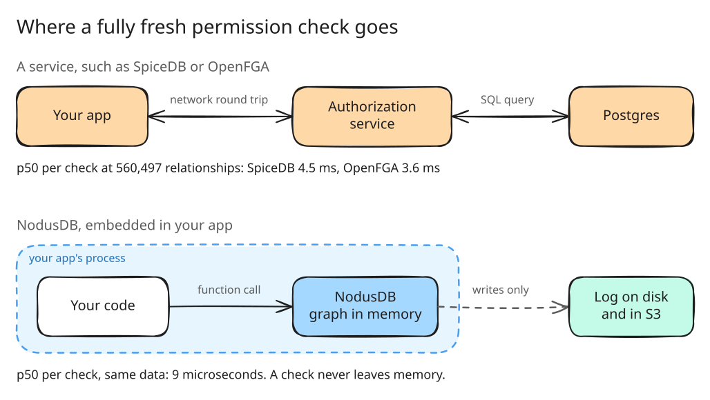
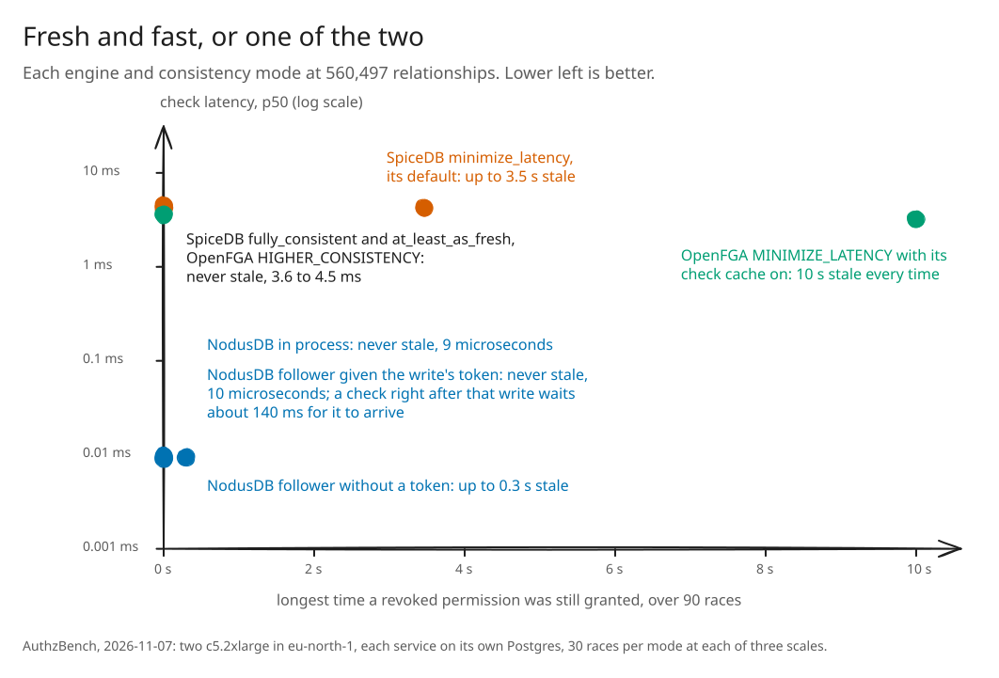
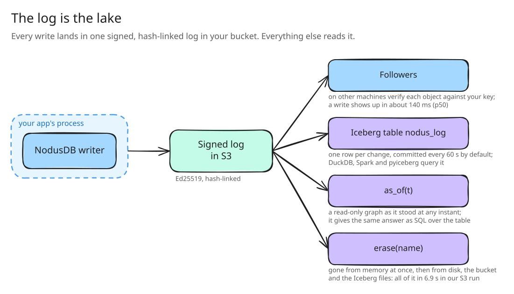

# NodusDB

[](https://github.com/Pragadeesh-19/nodusdb/actions/workflows/ci.yml)
[](https://pypi.org/project/nodusdb/)
[](https://pypi.org/project/nodusdb/)
[](LICENSE)

**Zanzibar-style permissions that run inside your Python process, on a log that is also your lake.**

Most authorization systems are a service you call. NodusDB is a library you import. It keeps the relationship graph
in your process's memory, so a permission check that must reflect every write so far is a function call: 9
microseconds at the median over 560,497 relationships. SpiceDB and OpenFGA answer the same check in 4.5 ms and 3.6 ms,
over the network, with Postgres behind them.

Every write also goes into one signed, hash-linked log in your own bucket. That log is the database's durability, the
stream its replicas follow, an Iceberg table you can query with SQL, and a record of the past you can open at any
instant. There is no server to run: `pip install nodusdb` and import it.



## The numbers

We measured NodusDB against SpiceDB 1.57.0 and OpenFGA 1.22.1 with
[AuthzBench](https://github.com/Pragadeesh-19/authzbench), a separate benchmark with one adapter per engine, on two
c5.2xlarge machines in AWS eu-north-1. Every engine had to give the same answers as a reference evaluator on 50,001
checks before anything was timed. These rows are the largest dataset, 560,497 relationships:

| Engine and consistency mode | Check, p50 | Check, p99 | At 1,000 checks/s, p50 | A revoked permission still granted for |
|---|---:|---:|---:|---|
| NodusDB, in your process | 9 µs | 17 µs | 12 µs | never |
| NodusDB follower, with the write's token | 10 µs | 19 µs | 13 µs | never (a check right after the write waits about 140 ms for it) |
| NodusDB follower, without a token | 9 µs | 18 µs | 12 µs | up to 0.30 s |
| SpiceDB `fully_consistent` | 4.5 ms | 16.5 ms | 5.5 s | never |
| SpiceDB `at_least_as_fresh` | 4.3 ms | 16.2 ms | 5.6 s | never |
| SpiceDB `minimize_latency` (its default) | 4.3 ms | 15.5 ms | 5.4 s | up to 3.5 s |
| OpenFGA `HIGHER_CONSISTENCY` | 3.6 ms | 22.7 ms | 6.6 s | never |
| OpenFGA `MINIMIZE_LATENCY` (check cache on) | 3.2 ms | 21.6 ms | 6.3 s | 10.0 s, every time |

The last column is the longest time a check still said "allowed" after the revoke was acknowledged, over 90 races
per mode (30 at each of three dataset sizes). The 1,000 checks/s column is an open loop, where each check is timed
from when it was due, so a queue shows up as latency. At that rate SpiceDB and OpenFGA used 93 to 100% of the 8-vCPU
machine they shared with their Postgres, and their checks queued for seconds. NodusDB stayed flat.



The size of the graph barely moves NodusDB. Check p50 at the three dataset sizes:

| Relationships | NodusDB, in process | SpiceDB `fully_consistent` | OpenFGA `HIGHER_CONSISTENCY` |
|---|---:|---:|---:|
| 5,487 | 7 µs | 3.4 ms | 2.4 ms |
| 55,756 | 8 µs | 2.8 ms | 1.9 ms |
| 560,497 | 9 µs | 4.5 ms | 3.6 ms |

### How we kept it fair

- SpiceDB and OpenFGA ran with the connection pools their production guides prescribe, each on its own Postgres 17,
  and OpenFGA with its check cache on, as its guide recommends. Each run started from a fresh database.
- They were driven by a Go program on their official clients with up to 256 checks in flight. NodusDB was driven
  through its Python API with one check at a time. Every handicap in that setup lands on NodusDB.
- The driver ran on a second machine, and so did the NodusDB follower, so every remote number includes a real
  network.
- Before any engine is timed, both drivers measure a calibration engine with a known staleness of 500 ms. They
  report it within 1 ms at the median and within 2 ms on every trial.
- CPU was sampled every second on both machines and is published with the results, as are the configs, seeds,
  container digests and every revocation trial.
- We wrote AuthzBench, so it is public, and its README invites SpiceDB's and OpenFGA's maintainers to change any
  setting, adapter or method by pull request. An accepted change means a new run, never an edited number.

[AuthzBench](https://github.com/Pragadeesh-19/authzbench) has the raw JSON for all three sizes, the CPU traces, the
machine records and the commands that rerun it. [docs/benchmarks.md](docs/benchmarks.md) has the longer
write-up.

### Where NodusDB loses

- A follower on another machine learns about writes through the bucket, so it trails the writer by about 140 ms at
  the median and 0.3 s at worst. SpiceDB's and OpenFGA's fresh modes see a write as soon as it commits, because every
  check goes to the database.
- A durable write through the NodusDB writer, synced to disk and shipped, took 4.4 ms at the median. SpiceDB and
  OpenFGA acknowledged writes in 2.0 to 2.4 ms.
- There is no `LookupResources` or `LookupSubjects` yet, so you cannot ask "which documents can Alice see". Both
  services can.
- One process writes at a time, the schema language has union only, and the API is Python only.
- Each process that answers checks holds the whole graph in its memory.

## Try it

```sh
pip install nodusdb
```

You need Python 3.10 or newer on Linux (x86_64 or arm64, glibc 2.34 or newer), macOS 11 or newer, or Windows x86_64.
The wheel carries a native library built with GraalVM, so there is nothing else to install and no JVM runs in your
process.

A schema, a few relationship tuples and a check. A document inherits access from its folder, the folder grants it to
a group, and groups nest:

```python
import nodusdb

SCHEMA = """
schema 1
type user
type group { relation member: user | group#member }
type folder {
  relation viewer: user | group#member
  relation parent: folder
  permission view = viewer + parent->view
}
type document {
  relation parent: folder
  relation viewer: user | group#member
  permission view = viewer + parent->view
}
"""

with nodusdb.Graph(path="/data/authz", sync_mode="sync") as g:
    g.apply_schema(SCHEMA)
    g.add_tuple("document:readme", "parent", "folder:eng")
    g.add_tuple("folder:eng", "viewer", "group:staff", "member")
    g.add_tuple("group:staff", "member", "group:backend", "member")
    token = g.add_tuple("group:backend", "member", "user:alice")

    g.check("document:readme", "view", "user:alice", at_least=token)    # True
    g.check("document:readme", "view", "user:bob")                       # False
```

Every write returns a token. Passing it as `at_least` makes a check refuse to answer from a state older than that
write, which is how a follower stays correct. Transactions group writes so that all of them apply or none do. A
derived index of group nesting turns a check through 1,111 nested groups from over 100 µs into under 1 µs. With `path=` the graph is
durable: a checksummed write-ahead log, snapshots, and recovery that is tested against a simulated disk that tears
writes at many byte offsets. [docs/permissions.md](docs/permissions.md) covers the schema language and every call.

## The log is the lake

Give the graph a bucket and a signing key, and it ships its log as it writes. Each object in the chain is signed with
Ed25519 and carries the SHA-256 of the object before it, so a reader can detect a gap, a reordering or a forgery. A
reader never takes the public key from the bucket.



```python
from nodusdb import Graph, Shipping, Transaction

shipping = Shipping.s3("my-bucket", "eu-north-1", prefix="authz", key_file="signing.pem", key_id=1,
                       public_key_file="signing.pub", iceberg=True)

with Graph(path="/data/authz", sync_mode="sync", shipping=shipping) as g:
    g.apply_schema(SCHEMA)                             # the schema from "Try it"
    granted = g.write(Transaction().add("document:plan", "viewer", "user:bob"), durability="lake")

    with g.as_of(granted) as then:                     # the graph as it stood at that write
        then.check("document:plan", "view", "user:bob")

    g.wait_erased(g.erase("user:bob"))                 # gone from memory, disk, bucket and lake
```

The same chain becomes an Iceberg v2 table, `nodus_log`, with one row per change and names rather than ids. DuckDB,
Spark and pyiceberg read it directly:

```sql
SELECT commit_ts, event, subject_type || ':' || subject_id AS subject
FROM iceberg_scan('s3://my-bucket/authz/iceberg/metadata/v42.metadata.json')
WHERE object_type = 'document' AND object_id = 'plan' AND relation = 'viewer'
ORDER BY lsn;
```

We ran this end to end against S3 on a c5.xlarge, with the 5,487-relationship dataset:

| Question | What happened |
|---|---|
| Who could view the document at a given instant? | `as_of` rebuilt the graph from S3 in 214 to 248 ms and answered 1,002 checks in 6 ms. A recursive DuckDB query over the Iceberg table took 122 to 245 ms. Both gave the same viewers. |
| Forget a user with 10 grants | `erase` cleaned memory in 0.22 ms. `wait_erased` returned once the local directory (0.14 s), the Iceberg files (2.2 s) and the bucket (6.9 s) were scrubbed. A byte scan then found the name in none of the 7 places it had been. |
| How fresh is the lake? | A write reached the Iceberg table in 31 s at the median and 61 s at worst, at the default 60 s commit interval. |

Followers, restore, takeover by a new writer, salvage of a dead writer's last transactions, a change feed, and
`AccessWatch` for "whose access just flipped" all read the same chain. [docs/operations.md](docs/operations.md) has
the details, the failure behavior and the costs, and [docs/vision.md](docs/vision.md) explains why we built it this
way.

## Also in the box

The permission system sits on a general graph engine, and the same native-memory design also powers a write buffer
for Parquet tables.

```python
with nodusdb.Graph() as g:
    g.add_edges_from([(1, 2), (2, 3), (3, 4), (1, 5), (5, 4)])
    g.khop(start=1, max_depth=3)          # [2, 5, 3, 4]
    g.common_neighbors(3, 5)              # [4]

with nodusdb.LakeTable("orders", {"amount": "int64", "label": "utf8"}) as table:
    table.upsert("order-101", {"amount": 5000, "label": "cleared"})
    table.delete("order-102")             # flushed as Parquet data and delete files on close
```

On a laptop (measured 2026-10-20, single runs), the graph engine loaded 1,000,000 edges at 810,031 per second and
answered a 3-hop query in 11.5 µs, against 207,937 edges per second and 26.2 µs for NetworkX. `LakeTable` ingested a
million rows of NYC taxi data at 994,900 rows per second and took a columnar batch of upserts at 2 million rows per
second. [docs/graph.md](docs/graph.md), [docs/lake-guide.md](docs/lake-guide.md) and
[docs/benchmarks.md](docs/benchmarks.md) have the guides, the methods and where the other engines win.

## How it works, briefly

- A node's neighbors are a sparse set: a packed array plus an index, so insert, delete and membership take constant
  time and a scan reads one array in order.
- The index is an open-addressing hash table with backward-shift deletion, so churn never leaves tombstones.
- A node with fewer than 16 neighbors uses a fixed 128-byte block in a shared slab. Above that it gets its own set,
  and it only moves back at 8, so a node near the boundary does not thrash.
- Everything lives in native memory, in chunks that double and never move. The garbage collector has nothing to
  scan, and a memory budget can refuse a write before anything changes.
- One writer and many readers. Readers take no lock: they read a sequence counter and retry if a write overlapped
  them, and every read path is written so that a torn read gives a wrong answer that the retry discards.
- A permission tuple is packed into one 64-bit key, relation and subject relation beside the id, so a direct grant
  is one hash probe.
- Queries and writes allocate nothing after warm-up. A test reads the thread's allocation counter and requires zero.
- The engine is Java compiled ahead of time by GraalVM Native Image into a C library. Python calls it through
  `ctypes`.

[docs/how-it-works.md](docs/how-it-works.md) builds each of these from first principles, and
[docs/architecture.md](docs/architecture.md) has the byte layouts. Every design choice, with its evidence, is a
numbered row in [docs/decisions.md](docs/decisions.md).

## Compatibility

This is what 0.1.x promises. A golden graph directory in the test suite pins the first two items: every build opens
it with the current code.

- Graph directories. The on-disk format does not change within 0.1.x. A directory written by any 0.1.x release opens
  in every later 0.1.x release. A release that meets a newer format refuses to open it and leaves the files alone.
- Directories from 0.1.0rc1 are refused until `nodusdb.upgrade(path)` converts them. The upgrade keeps the originals
  in `pre-v2/`.
- The Python API. The names and signatures in these docs stay in 0.1.x. Releases may add new ones. A change that
  breaks an existing call waits for 0.2.
- Not covered yet: the signed chain in the bucket and the Iceberg table carry their own format versions, but this
  promise does not cover them.

## Limits

- One writer. Writes on one handle run one at a time; readers run in parallel.
- Failover is manual. Nothing decides by itself that the writer is dead.
- Followers trail the writer by the time it takes to ship through the bucket, about 140 ms at the median.
- No lookup APIs yet, and the schema language has union only. Intersection and exclusion are not built.
- Checkpoints pause writes while they write the snapshot, about 9 seconds at 30.6 million edges, and a restart at
  that size takes about 3 seconds to recover.
- No compaction in `LakeTable`, and reads that reach committed files decode whole files.
- Each Python call costs a few microseconds. Use the batch forms for bulk work.
- No wheels yet for Alpine (musl), Linux with glibc older than 2.34, or Windows on ARM.
- Use 0.1.1 or later. 0.1.0 read native memory through an API that costs about 300 ns per access when compiled ahead
  of time, which made it several times slower.

[TODOS.md](TODOS.md) lists each open item with its reason.

## Contributing

NodusDB is small enough to read in a weekend, and it needs more people than one. [CONTRIBUTING.md](CONTRIBUTING.md)
covers how to build it, the rules the code follows, and where help is wanted. The shortest way in is
[docs/how-it-works.md](docs/how-it-works.md), then one of the open items in [TODOS.md](TODOS.md).

```sh
git clone https://github.com/Pragadeesh-19/nodusdb && cd nodusdb
mvn test                       # the Java suite; no GraalVM needed
```

## Documentation

[docs/README.md](docs/README.md) is the index.

- Using it: [permissions](docs/permissions.md), [operations](docs/operations.md), [graph](docs/graph.md),
  [lake](docs/lake-guide.md), [benchmarks](docs/benchmarks.md).
- Understanding it: [vision](docs/vision.md), [how it works](docs/how-it-works.md),
  [architecture](docs/architecture.md), [decisions](docs/decisions.md).
- Working on it: [CONTRIBUTING](CONTRIBUTING.md), [building and testing](docs/building.md), [TODOS](TODOS.md),
  [CHANGELOG](CHANGELOG.md).

## License and status

Licensed under the [Apache License, Version 2.0](LICENSE).

Status: 0.1.1, beta. Built and tested in CI on Linux, macOS and Windows: the graph engine, durability, typed tuples
and permission checks, the index for nested groups, log shipping with followers, restore and takeover, erasure,
change watching, time travel, the Iceberg projection and the lake write path.
