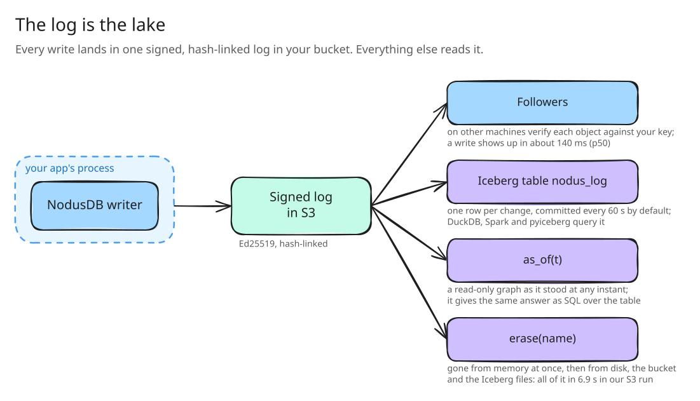

# Vision: the log is the lake

NodusDB started from one observation about relationship data, the kind that says who belongs to which group, who can
open which document, which folder sits inside which.

Two kinds of question get asked about it, and today they are answered by two different systems.

The first kind is about now. Can Alice open this document? It has to be answered in the request path, thousands of
times a second, and it has to be right the moment a permission is revoked. Google built Zanzibar for this, and
SpiceDB and OpenFGA brought the model to everyone else. They run it as a network service in front of a database.

The second kind is about then. Who could open this document last Tuesday? What changed between the audit and the
breach? Has every trace of a deleted user really gone? Those questions go to logs, a warehouse fed by an ETL job, or
a person with a spreadsheet. The answers are slow, partial, and usually assembled after someone asks.

We think the split is the problem. The live index and its history are the same data seen at different times, so we
keep them as one thing.

## One log, read four ways

NodusDB keeps the relationship graph inside your application's process, in native memory, so a check is a function
call. Every change goes into one ordered log first. That log is shipped to your own bucket as a chain of objects,
each signed with Ed25519 and linked to the one before it by its SHA-256 hash. Everything else reads that chain:

- Durability. A restart replays the log on top of the newest snapshot.
- Replication. Followers on other machines rebuild the graph from the bucket and check every signature against a
  public key you give them. The bucket is never trusted for the key.
- The lake. A projector turns the same chain into an Iceberg v2 table, `nodus_log`, with one row per change.
  DuckDB, Spark and pyiceberg query it with plain SQL.
- The past. `as_of(t)` rebuilds a read-only graph as it stood at any instant the bucket still covers.

Because there is one log, the audit trail cannot drift from the database, and a replica cannot hold a change the
log never recorded. Erasure becomes tractable too. `erase(name)` removes a person's tuples, replaces the name with a
pseudonym, and then works through every copy NodusDB manages (memory, the local directory, the chain in the bucket and
the Iceberg files) until `wait_erased` can say all of them are clean.

## What this costs

Holding the graph in the application has real costs, and we would rather name them than have you find them.

- Memory. Each process that answers checks holds the graph. NodusDB keeps the layout tight (a node with fewer
  than 16 neighbors lives in one 128-byte block), but a graph of hundreds of millions of tuples needs a machine
  sized for it.
- Freshness across machines. A follower learns about a write from the bucket, so it trails the writer by about
  140 ms at the median and up to 0.3 s in our runs. A check that carries the write's token waits for it rather than
  answering stale. A direct writer-to-follower stream is planned and not built.
- One writer. Writes go through one process at a time, and failover to a new writer is a manual takeover.
- One language. The engine is a native library with a Python API. Other bindings are planned.

[docs/benchmarks.md](benchmarks.md) and [AuthzBench](https://github.com/Pragadeesh-19/authzbench) put numbers on
each of these, next to the numbers where NodusDB wins.

## Where it goes next

The open items are in [TODOS.md](../TODOS.md), each with its reason and size. The larger ones:

- A Go binding over the same C interface.
- A direct stream from the writer to its followers, so freshness across machines no longer waits on the bucket.
- `LookupResources` and `LookupSubjects`, so you can ask what a user can see and not just whether they can see one
  thing.
- Intersection and exclusion in the schema language.
- Memory for AI agents, with provenance. An agent's facts and their sources are relationships too, and "what did the
  agent know when it decided this" is an `as_of` question.

The design decisions behind all of this, with the evidence for each, are numbered in
[decisions.md](decisions.md). The engineering reviews that froze each build step are in [designs/](designs/).
